# Desktop Detective — Crafting Guide

A simple crafting guide for Desktop Detective, showing what items to hold onto for crafting and what ingredients create which items.

After Rebirthing for the first time, you now unlock Forging. Clicking on this menu will allow you to combine two pieces of loot to make an even stronger piece of loot if they're part of a crafting recipe.

Unlike previous games which only allowed crafting from loot on the floor, Desktop Detective will pull ingredients directly out of any equipped loadout as well as the floor (the Forging menu indicates which loadout or floor each piece of loot is on).

You can track items found, crafted, and recipes in your compendium.

## Table of contents

- [Ingredient items](#ingredient-items)
- [Crafted items](#crafted-items)
- [Craft progression](#craft-progression)
  - [Alloy Bunch](#alloy-bunch)
  - [Ancient Piece](#ancient-piece)
  - [Beast Bone Armor](#beast-bone-armor)
  - [Burned Material](#burned-material)
  - [Cheesecloth](#cheesecloth)
  - [Climbing Gloves](#climbing-gloves)
  - [Cloak](#cloak)
  - [Corrupted Mask](#corrupted-mask)
  - [Crazy Stick](#crazy-stick)
  - [Critical Nails](#critical-nails)
  - [Dark Matter](#dark-matter)
  - [Dry Aged Meat](#dry-aged-meat)
  - [Extracted Life](#extracted-life)
  - [Fishing Solution](#fishing-solution)
  - [Food Rock](#food-rock)
  - [Full Stomach](#full-stomach)
  - [Good Poison](#good-poison)
  - [Holy Grail](#holy-grail)
  - [Lobster](#lobster)
  - [Locket](#locket)
  - [Manipulation](#manipulation)
  - [Phylogeny](#phylogeny)
  - [Pirate Victims](#pirate-victims)
  - [Pouch of Secrets](#pouch-of-secrets)
  - [Quantum Clapper](#quantum-clapper)
  - [Regal Dagger](#regal-dagger)
  - [Reinforced Brooch](#reinforced-brooch)
  - [Ribboned Emblem](#ribboned-emblem)
  - [Saintly Branch](#saintly-branch)
  - [Seized Chance](#seized-chance)
  - [Serrated Knife](#serrated-knife)
  - [Soaked Fang](#soaked-fang)
  - [Tentacle](#tentacle)
  - [Theory of Everything](#theory-of-everything)
  - [Time Cog](#time-cog)
  - [Trade Deal](#trade-deal)
  - [Trident](#trident)
  - [Undead Beast](#undead-beast)
  - [Vestigial Tail](#vestigial-tail)
  - [Yggdrasil Root](#yggdrasil-root)

## Ingredient items

Hold onto these items when they appear — they are used as crafting ingredients.

| Item | Used to craft |
| --- | --- |
| 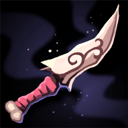 Adorned Dagger | Regal Dagger |
| 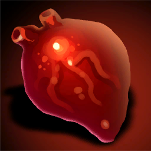 Adrenaline | Vestigial Tail |
|  Agreement | Trade Deal |
| 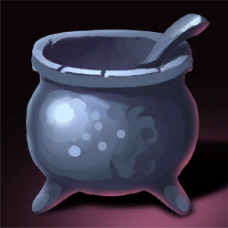 Alchemy | Witch Soup |
| 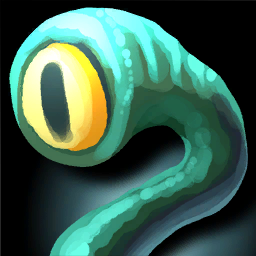 Alien Bait | Saintly Branch |
| 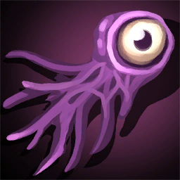 Alien Eye | Saintly Branch |
| 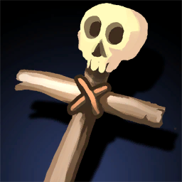 All or Nothing | Spine |
| 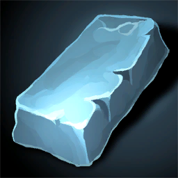 Alloy | Alloy Bunch |
| 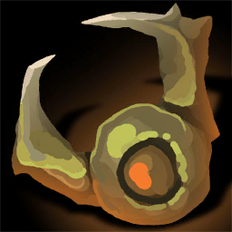 Ancient Hookshot | Climbing Gloves |
| 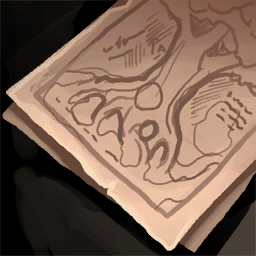 Ancient Texts | Ancient Piece, Theory of Everything |
| 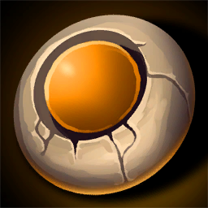 Ancient Timer | Full Stomach, Time Cog |
| 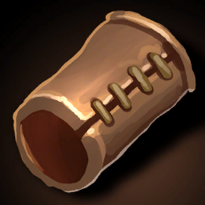 Armguard | Cloak |
| 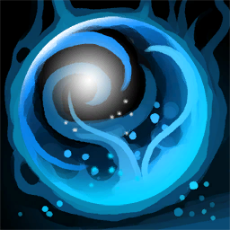 Authority | Cosmic Weave, Illuminating Notes |
| 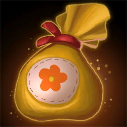 Bag of Tools | Pouch of Secrets |
| 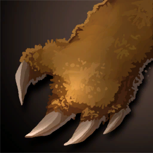 Bearskin | Gargoyle Body |
| 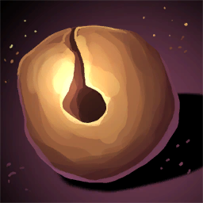 Bell | Sailor Bell |
| 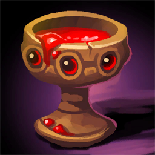 Blood Money | Locket |
| 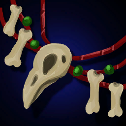 Bone Necklace | Witch Soup |
| 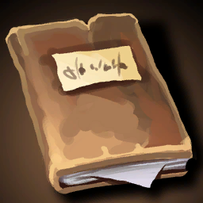 Book of Secrets | Phylogeny |
| 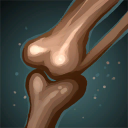 Brittle Bone | Self Trap |
| 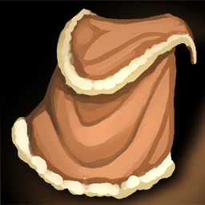 Cape | Cloak |
| 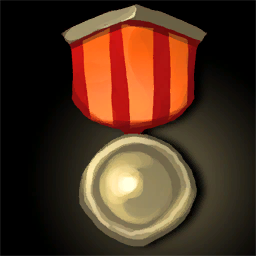 Captain Medal | Pirate Soul |
| 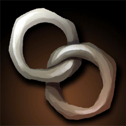 Chain Link | Critical Nails |
| 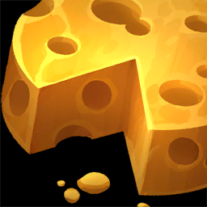 Cheese | Cheesecloth |
| 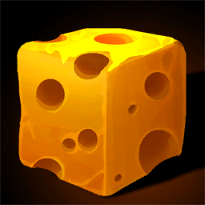 Cheese Cube | Defy Death |
| 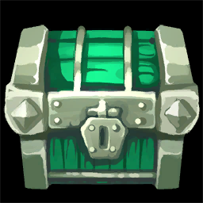 Chest | Locket |
| 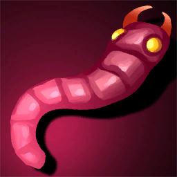 Clever Bloodworm | Extracted Life, Starfish |
| 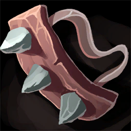 Climbing Claws | Climbing Gloves |
| 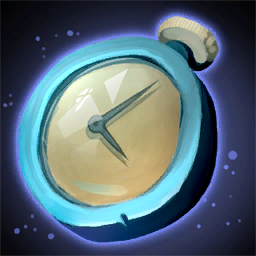 Clock | Time Cog |
| 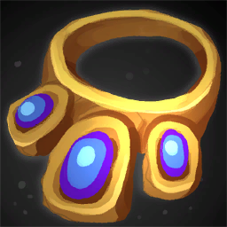 Collar | Reinforced Brooch |
|  Cosmic Pendant | Dark Matter |
| 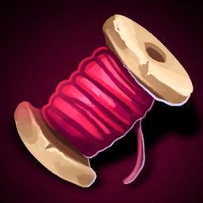 Cosmic Weave | Cosmic Pendant |
| 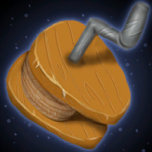 Crank | Full Stomach |
| 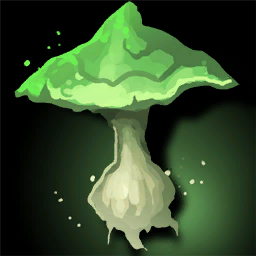 Cursed Shroom | Good Poison |
| 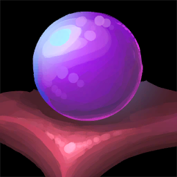 Dark Energy | Dark Matter |
| 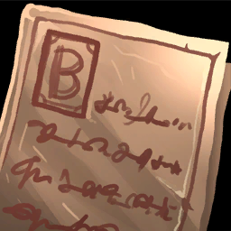 Deed | Trade Deal |
| 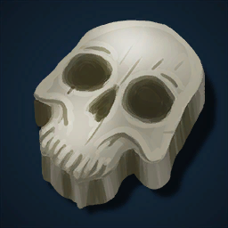 Defy Death | Extracted Life |
| 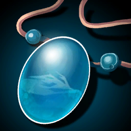 Detective Pendant | Dark Energy, Manipulation, Pirate Victims |
| 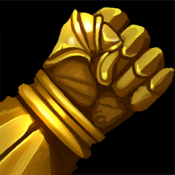 Determination | Alien Eye, Manipulation |
|  Dragon Stamp | Yin and Yang |
|  Dried Herb | Corrupted Mask |
| 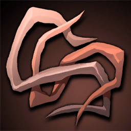 Dry Roots | Burned Material |
| 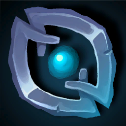 Emblem | Ribboned Emblem, Yin and Yang |
| 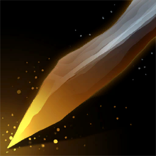 Etching Blade | Critical Nails, Serrated Knife |
| 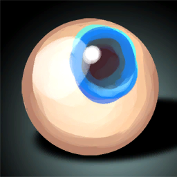 Eye | Alien Eye |
|  Face Reader | Ancient Piece |
| 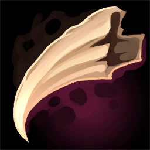 Fang | Soaked Fang |
| 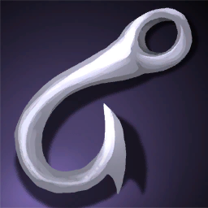 Fish Hook | Fishing Solution |
| 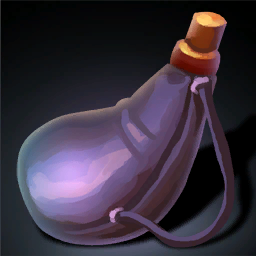 Flask | Soaked Fang |
| 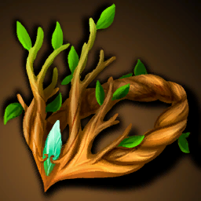 Forest Crown | Adrenaline, Corrupted Mask |
| 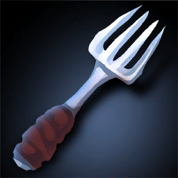 Fork | Serrated Knife |
| 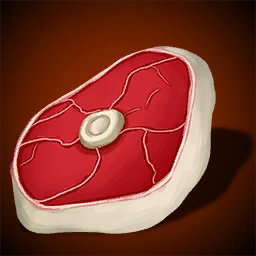 Fresh Flesh | Lobster |
| 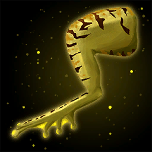 Frog Leg | Tentacle |
| 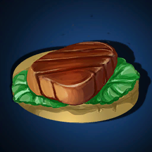 Full Meal | Lobster |
| 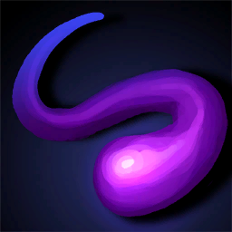 Fundamental Particle | Quantum Clapper |
|  Gamble | Crazy Stick |
|  Gargoyle Body | Food Rock |
|  Garlic | Food Rock |
|  Gold Bar | Adorned Dagger |
|  Greed | Dry Aged Meat |
|  Hanging by a Thread | Spine |
|  Healing Salt | Undead Beast |
|  Heavy Glove | Cheesecloth |
|  Heavy Matter | Cosmic Weave, Fundamental Particle |
|  Hollow Sticks | Self Trap |
|  Horn | Undead Beast |
|  Illuminating Notes | Theory of Everything |
|  Keen Eye | Strike Timer |
|  Light Funnel | Burned Material, Strike Timer |
|  Magic Tool | Cosmic Pendant |
|  Natural Claw | Trident |
|  Notes | Illuminating Notes |
|  Pear Stone | Beast Bone Armor |
|  Pirate Soul | Pirate Victims |
|  Poisonous Berry | Adrenaline, Good Poison |
|  Poking Tool | Primal Poking Tool |
|  Pouch of Tricks | Pouch of Secrets |
|  Predator Bones | Phylogeny |
|  Primal Poking Tool | Crazy Stick |
|  Primal Tool | Primal Poking Tool, Whittled Dagger |
|  Prism | Holy Grail |
|  Raven Staff | Trident |
|  Reinforced Armor | Beast Bone Armor |
|  Rock Bits | Reinforced Brooch |
|  Rock Ronch | Alloy Bunch |
|  Sailor Bell | Quantum Clapper |
|  Sailor's Token | Fundamental Particle, Sailor Bell |
|  Salve | Fishing Solution |
|  Scholar's Cloak | Bone Necklace |
|  Secret Explosion | Bag of Tools |
|  Secret Tool | Bag of Tools |
|  Self Trap | Seized Chance |
|  Ship Wheel | Pirate Soul |
|  Smart Worm | Starfish |
|  Spine | Vestigial Tail |
|  Stake | Whittled Dagger |
|  Starfish | Defy Death |
|  Strike Timer | Seized Chance |
|  Thunder Emblem | Holy Grail |
|  Tool Package | Ribboned Emblem |
|  Tuber | Garlic |
|  Undead Body | Gargoyle Body |
|  Very Old Nut | Dry Aged Meat |
|  Whittled Dagger | Adorned Dagger, Regal Dagger |
|  Wisdom Totem | Bone Necklace |
|  Witch Soup | Yggdrasil Root |
|  Wizard Shard | Dark Energy |
|  Yin and Yang | Yggdrasil Root |
|  Yummy Egg | Garlic |

## Crafted items

This is a list of items that must be crafted. Some of the items are used to further craft other items.

| Crafted item | Ingredient 1 | Ingredient 2 |
| --- | --- | --- |
|  Adorned Dagger | Whittled Dagger | Gold Bar |
|  Adrenaline | Forest Crown | Poisonous Berry |
|  Alien Eye | Eye | Determination |
|  Alloy Bunch | Alloy | Rock Ronch |
|  Ancient Piece | Ancient Texts | Face Reader |
|  Bag of Tools | Secret Tool | Secret Explosion |
|  Beast Bone Armor | Reinforced Armor | Pear Stone |
|  Bone Necklace | Scholar's Cloak | Wisdom Totem |
|  Burned Material | Dry Roots | Light Funnel |
|  Cheesecloth | Cheese | Heavy Glove |
|  Climbing Gloves | Ancient Hookshot | Climbing Claws |
|  Cloak | Armguard | Cape |
|  Corrupted Mask | Dried Herb | Forest Crown |
|  Cosmic Pendant | Cosmic Weave | Magic Tool |
|  Cosmic Weave | Authority | Heavy Matter |
|  Crazy Stick | Primal Poking Tool | Gamble |
|  Critical Nails | Chain Link | Etching Blade |
|  Dark Energy | Detective Pendant | Wizard Shard |
|  Dark Matter | Dark Energy | Cosmic Pendant |
|  Defy Death | Starfish | Cheese Cube |
|  Dry Aged Meat | Very Old Nut | Greed |
|  Extracted Life | Clever Bloodworm | Defy Death |
|  Fishing Solution | Fish Hook | Salve |
|  Food Rock | Gargoyle Body | Garlic |
|  Full Stomach | Crank | Ancient Timer |
|  Fundamental Particle | Heavy Matter | Sailor's Token |
|  Gargoyle Body | Bearskin | Undead Body |
|  Garlic | Yummy Egg | Tuber |
|  Good Poison | Poisonous Berry | Cursed Shroom |
|  Holy Grail | Prism | Thunder Emblem |
|  Illuminating Notes | Notes | Authority |
|  Lobster | Fresh Flesh | Full Meal |
|  Locket | Blood Money | Chest |
|  Manipulation | Detective Pendant | Determination |
|  Phylogeny | Predator Bones | Book of Secrets |
|  Pirate Soul | Captain Medal | Ship Wheel |
|  Pirate Victims | Detective Pendant | Pirate Soul |
|  Pouch of Secrets | Pouch of Tricks | Bag of Tools |
|  Primal Poking Tool | Primal Tool | Poking Tool |
|  Quantum Clapper | Sailor Bell | Fundamental Particle |
|  Regal Dagger | Adorned Dagger | Whittled Dagger |
|  Reinforced Brooch | Rock Bits | Collar |
|  Ribboned Emblem | Tool Package | Emblem |
|  Sailor Bell | Sailor's Token | Bell |
|  Saintly Branch | Alien Eye | Alien Bait |
|  Seized Chance | Self Trap | Strike Timer |
|  Self Trap | Brittle Bone | Hollow Sticks |
|  Serrated Knife | Fork | Etching Blade |
|  Soaked Fang | Fang | Flask |
|  Spine | Hanging by a Thread | All or Nothing |
|  Starfish | Clever Bloodworm | Smart Worm |
|  Strike Timer | Keen Eye | Light Funnel |
|  Tentacle | Frog Leg | Frog Leg |
|  Theory of Everything | Ancient Texts | Illuminating Notes |
|  Time Cog | Ancient Timer | Clock |
|  Trade Deal | Agreement | Deed |
|  Trident | Natural Claw | Raven Staff |
|  Undead Beast | Healing Salt | Horn |
|  Vestigial Tail | Adrenaline | Spine |
|  Whittled Dagger | Stake | Primal Tool |
|  Witch Soup | Bone Necklace | Alchemy |
|  Yggdrasil Root | Yin and Yang | Witch Soup |
|  Yin and Yang | Emblem | Dragon Stamp |

## Craft progression

Each diagram shows recipe steps for one path to a final crafted item. Arrows run from ingredients toward the item they combine into.

### Alloy Bunch

 **Alloy**
 **Rock Ronch**
 **Alloy Bunch**


### Ancient Piece

 **Ancient Texts**
 **Face Reader**
 **Ancient Piece**


### Beast Bone Armor

 **Reinforced Armor**
 **Pear Stone**
 **Beast Bone Armor**


### Burned Material

 **Dry Roots**
 **Light Funnel**
 **Burned Material**


### Cheesecloth

 **Cheese**
 **Heavy Glove**
 **Cheesecloth**


### Climbing Gloves

 **Ancient Hookshot**
 **Climbing Claws**
 **Climbing Gloves**


### Cloak

 **Armguard**
 **Cape**
 **Cloak**


### Corrupted Mask

 **Dried Herb**
 **Forest Crown**
 **Corrupted Mask**


### Crazy Stick

 **Primal Tool**
 **Poking Tool**
 **Primal Poking Tool**
 **Gamble**
 **Crazy Stick**


### Critical Nails

 **Chain Link**
 **Etching Blade**
 **Critical Nails**


### Dark Matter

 **Detective Pendant**
 **Wizard Shard**
 **Dark Energy**
 **Authority**
 **Heavy Matter**
 **Cosmic Weave**
 **Magic Tool**
 **Cosmic Pendant**
 **Dark Matter**


### Dry Aged Meat

 **Very Old Nut**
 **Greed**
 **Dry Aged Meat**


### Extracted Life

 **Clever Bloodworm**
 **Smart Worm**
 **Starfish**
 **Cheese Cube**
 **Defy Death**
 **Extracted Life**


### Fishing Solution

 **Fish Hook**
 **Salve**
 **Fishing Solution**


### Food Rock

 **Bearskin**
 **Undead Body**
 **Gargoyle Body**
 **Yummy Egg**
 **Tuber**
 **Garlic**
 **Food Rock**


### Full Stomach

 **Crank**
 **Ancient Timer**
 **Full Stomach**


### Good Poison

 **Poisonous Berry**
 **Cursed Shroom**
 **Good Poison**


### Holy Grail

 **Prism**
 **Thunder Emblem**
 **Holy Grail**


### Lobster

 **Fresh Flesh**
 **Full Meal**
 **Lobster**


### Locket

 **Blood Money**
 **Chest**
 **Locket**


### Manipulation

 **Detective Pendant**
 **Determination**
 **Manipulation**

```mermaid
%%{init: {'flowchart': {'nodeSpacing': 80}}}%%
flowchart TD
  detective_pendant["Detective Pendant"]
  determination["Determination"]
  manipulation["Manipulation"]
  detective_pendant --> manipulation
  determination --> manipulation
```

### Phylogeny

 **Predator Bones**
 **Book of Secrets**
 **Phylogeny**

```mermaid
%%{init: {'flowchart': {'nodeSpacing': 80}}}%%
flowchart TD
  predator_bones["Predator Bones"]
  book_of_secrets["Book of Secrets"]
  phylogeny["Phylogeny"]
  book_of_secrets --> phylogeny
  predator_bones --> phylogeny
```

### Pirate Victims

 **Detective Pendant**
 **Captain Medal**
 **Ship Wheel**
 **Pirate Soul**
 **Pirate Victims**

```mermaid
%%{init: {'flowchart': {'nodeSpacing': 80}}}%%
flowchart TD
  detective_pendant["Detective Pendant"]
  captain_medal["Captain Medal"]
  ship_wheel["Ship Wheel"]
  pirate_soul["Pirate Soul"]
  pirate_victims["Pirate Victims"]
  captain_medal --> pirate_soul
  detective_pendant --> pirate_victims
  pirate_soul --> pirate_victims
  ship_wheel --> pirate_soul
```

### Pouch of Secrets

 **Pouch of Tricks**
 **Secret Tool**
 **Secret Explosion**
 **Bag of Tools**
 **Pouch of Secrets**

```mermaid
%%{init: {'flowchart': {'nodeSpacing': 80}}}%%
flowchart TD
  pouch_of_tricks["Pouch of Tricks"]
  secret_tool["Secret Tool"]
  secret_explosion["Secret Explosion"]
  bag_of_tools["Bag of Tools"]
  pouch_of_secrets["Pouch of Secrets"]
  bag_of_tools --> pouch_of_secrets
  pouch_of_tricks --> pouch_of_secrets
  secret_explosion --> bag_of_tools
  secret_tool --> bag_of_tools
```

### Quantum Clapper

 **Sailor's Token**
 **Bell**
 **Sailor Bell**
 **Heavy Matter**
 **Fundamental Particle**
 **Quantum Clapper**

```mermaid
%%{init: {'flowchart': {'nodeSpacing': 80}}}%%
flowchart TD
  sailor_s_token["Sailor's Token"]
  bell["Bell"]
  sailor_bell["Sailor Bell"]
  heavy_matter["Heavy Matter"]
  fundamental_particle["Fundamental Particle"]
  quantum_clapper["Quantum Clapper"]
  bell --> sailor_bell
  fundamental_particle --> quantum_clapper
  heavy_matter --> fundamental_particle
  sailor_bell --> quantum_clapper
  sailor_s_token --> fundamental_particle
  sailor_s_token --> sailor_bell
```

### Regal Dagger

 **Stake**
 **Primal Tool**
 **Whittled Dagger**
 **Gold Bar**
 **Adorned Dagger**
 **Regal Dagger**

```mermaid
%%{init: {'flowchart': {'nodeSpacing': 80}}}%%
flowchart TD
  stake["Stake"]
  primal_tool["Primal Tool"]
  whittled_dagger["Whittled Dagger"]
  gold_bar["Gold Bar"]
  adorned_dagger["Adorned Dagger"]
  regal_dagger["Regal Dagger"]
  adorned_dagger --> regal_dagger
  gold_bar --> adorned_dagger
  primal_tool --> whittled_dagger
  stake --> whittled_dagger
  whittled_dagger --> adorned_dagger
  whittled_dagger --> regal_dagger
```

### Reinforced Brooch

 **Rock Bits**
 **Collar**
 **Reinforced Brooch**

```mermaid
%%{init: {'flowchart': {'nodeSpacing': 80}}}%%
flowchart TD
  rock_bits["Rock Bits"]
  collar["Collar"]
  reinforced_brooch["Reinforced Brooch"]
  collar --> reinforced_brooch
  rock_bits --> reinforced_brooch
```

### Ribboned Emblem

 **Tool Package**
 **Emblem**
 **Ribboned Emblem**

```mermaid
%%{init: {'flowchart': {'nodeSpacing': 80}}}%%
flowchart TD
  tool_package["Tool Package"]
  emblem["Emblem"]
  ribboned_emblem["Ribboned Emblem"]
  emblem --> ribboned_emblem
  tool_package --> ribboned_emblem
```

### Saintly Branch

 **Eye**
 **Determination**
 **Alien Eye**
 **Alien Bait**
 **Saintly Branch**

```mermaid
%%{init: {'flowchart': {'nodeSpacing': 80}}}%%
flowchart TD
  eye["Eye"]
  determination["Determination"]
  alien_eye["Alien Eye"]
  alien_bait["Alien Bait"]
  saintly_branch["Saintly Branch"]
  alien_bait --> saintly_branch
  alien_eye --> saintly_branch
  determination --> alien_eye
  eye --> alien_eye
```

### Seized Chance

 **Brittle Bone**
 **Hollow Sticks**
 **Self Trap**
 **Keen Eye**
 **Light Funnel**
 **Strike Timer**
 **Seized Chance**

```mermaid
%%{init: {'flowchart': {'nodeSpacing': 80}}}%%
flowchart TD
  brittle_bone["Brittle Bone"]
  hollow_sticks["Hollow Sticks"]
  self_trap["Self Trap"]
  keen_eye["Keen Eye"]
  light_funnel["Light Funnel"]
  strike_timer["Strike Timer"]
  seized_chance["Seized Chance"]
  brittle_bone --> self_trap
  hollow_sticks --> self_trap
  keen_eye --> strike_timer
  light_funnel --> strike_timer
  self_trap --> seized_chance
  strike_timer --> seized_chance
```

### Serrated Knife

 **Fork**
 **Etching Blade**
 **Serrated Knife**

```mermaid
%%{init: {'flowchart': {'nodeSpacing': 80}}}%%
flowchart TD
  fork["Fork"]
  etching_blade["Etching Blade"]
  serrated_knife["Serrated Knife"]
  etching_blade --> serrated_knife
  fork --> serrated_knife
```

### Soaked Fang

 **Fang**
 **Flask**
 **Soaked Fang**

```mermaid
%%{init: {'flowchart': {'nodeSpacing': 80}}}%%
flowchart TD
  fang["Fang"]
  flask["Flask"]
  soaked_fang["Soaked Fang"]
  fang --> soaked_fang
  flask --> soaked_fang
```

### Tentacle

 **Frog Leg**
 **Tentacle**

```mermaid
%%{init: {'flowchart': {'nodeSpacing': 80}}}%%
flowchart TD
  frog_leg["Frog Leg"]
  tentacle["Tentacle"]
  frog_leg --> tentacle
```

### Theory of Everything

 **Ancient Texts**
 **Notes**
 **Authority**
 **Illuminating Notes**
 **Theory of Everything**

```mermaid
%%{init: {'flowchart': {'nodeSpacing': 80}}}%%
flowchart TD
  ancient_texts["Ancient Texts"]
  notes["Notes"]
  authority["Authority"]
  illuminating_notes["Illuminating Notes"]
  theory_of_everything["Theory of Everything"]
  ancient_texts --> theory_of_everything
  authority --> illuminating_notes
  illuminating_notes --> theory_of_everything
  notes --> illuminating_notes
```

### Time Cog

 **Ancient Timer**
 **Clock**
 **Time Cog**

```mermaid
%%{init: {'flowchart': {'nodeSpacing': 80}}}%%
flowchart TD
  ancient_timer["Ancient Timer"]
  clock["Clock"]
  time_cog["Time Cog"]
  ancient_timer --> time_cog
  clock --> time_cog
```

### Trade Deal

 **Agreement**
 **Deed**
 **Trade Deal**

```mermaid
%%{init: {'flowchart': {'nodeSpacing': 80}}}%%
flowchart TD
  agreement["Agreement"]
  deed["Deed"]
  trade_deal["Trade Deal"]
  agreement --> trade_deal
  deed --> trade_deal
```

### Trident

 **Natural Claw**
 **Raven Staff**
 **Trident**

```mermaid
%%{init: {'flowchart': {'nodeSpacing': 80}}}%%
flowchart TD
  natural_claw["Natural Claw"]
  raven_staff["Raven Staff"]
  trident["Trident"]
  natural_claw --> trident
  raven_staff --> trident
```

### Undead Beast

 **Healing Salt**
 **Horn**
 **Undead Beast**

```mermaid
%%{init: {'flowchart': {'nodeSpacing': 80}}}%%
flowchart TD
  healing_salt["Healing Salt"]
  horn["Horn"]
  undead_beast["Undead Beast"]
  healing_salt --> undead_beast
  horn --> undead_beast
```

### Vestigial Tail

 **Forest Crown**
 **Poisonous Berry**
 **Adrenaline**
 **Hanging by a Thread**
 **All or Nothing**
 **Spine**
 **Vestigial Tail**

```mermaid
%%{init: {'flowchart': {'nodeSpacing': 80}}}%%
flowchart TD
  forest_crown["Forest Crown"]
  poisonous_berry["Poisonous Berry"]
  adrenaline["Adrenaline"]
  hanging_by_a_thread["Hanging by a Thread"]
  all_or_nothing["All or Nothing"]
  spine["Spine"]
  vestigial_tail["Vestigial Tail"]
  adrenaline --> vestigial_tail
  all_or_nothing --> spine
  forest_crown --> adrenaline
  hanging_by_a_thread --> spine
  poisonous_berry --> adrenaline
  spine --> vestigial_tail
```

### Yggdrasil Root

 **Emblem**
 **Dragon Stamp**
 **Yin and Yang**
 **Scholar's Cloak**
 **Wisdom Totem**
 **Bone Necklace**
 **Alchemy**
 **Witch Soup**
 **Yggdrasil Root**

```mermaid
%%{init: {'flowchart': {'nodeSpacing': 80}}}%%
flowchart TD
  emblem["Emblem"]
  dragon_stamp["Dragon Stamp"]
  yin_and_yang["Yin and Yang"]
  scholar_s_cloak["Scholar's Cloak"]
  wisdom_totem["Wisdom Totem"]
  bone_necklace["Bone Necklace"]
  alchemy["Alchemy"]
  witch_soup["Witch Soup"]
  yggdrasil_root["Yggdrasil Root"]
  alchemy --> witch_soup
  bone_necklace --> witch_soup
  dragon_stamp --> yin_and_yang
  emblem --> yin_and_yang
  scholar_s_cloak --> bone_necklace
  wisdom_totem --> bone_necklace
  witch_soup --> yggdrasil_root
  yin_and_yang --> yggdrasil_root
```
